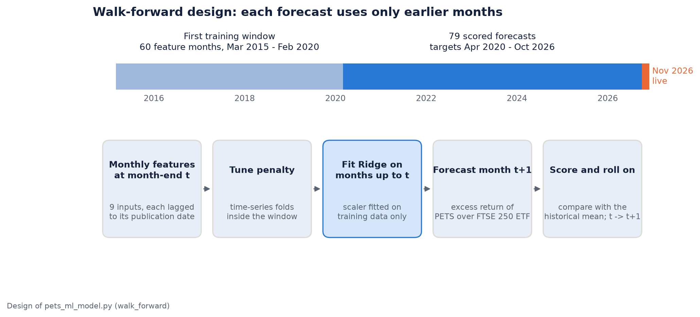
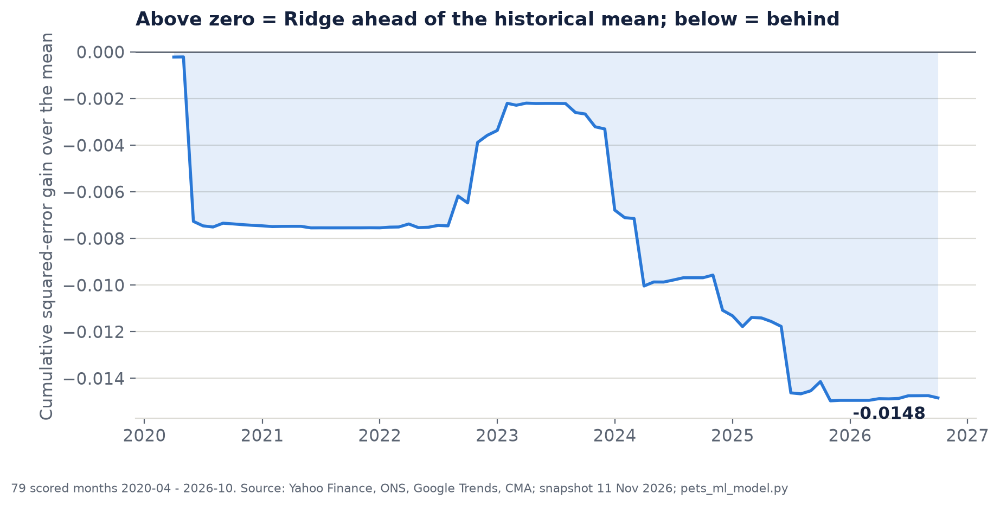
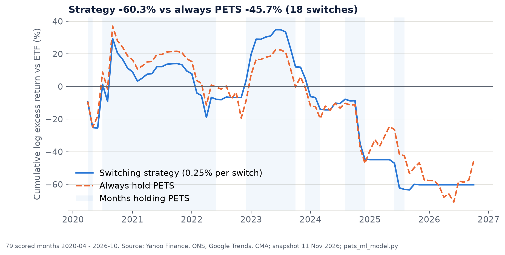

## Acknowledgement of Generative AI Use

I acknowledge the use of Claude Opus 5.5 (Anthropic, https://claude.ai) to help write the code in this repository between 13 November 2026 and 27 November 2026. Using generative AI was permitted for this course.

I planned the codebase in detail before any code was written. The plan set out the prediction target (PETS excess return over the FTSE 250 ETF), the nine input features and their publication lags, the Ridge model with time-series cross-validation, the expanding-window walk-forward test, the benchmarks, the statistical tests and the 0%/25% decision rule. I gave this plan to Claude as specifications, and Claude wrote code from them. I reviewed every piece of output. I corrected and refined the code by re-prompting with specific changes and by editing files myself. Every methodological and implementation decision, down to small details, was mine and was based on my own research. Claude did not choose the approach. It turned my decisions into working code under my direction.

The main tasks I prompted Claude with were:
- Building the data pipeline and feature construction in `pets_ml_model.py` to my feature list and lag rules
- Implementing the walk-forward Ridge model, the OLS and historical-mean benchmarks, and the out-of-sample R², Diebold–Mariano, Clark–West and bootstrap statistics
- Adding the robustness checks, the switching backtest with transaction costs, and the power check
- Writing `make_charts.py` to produce the charts in `results/charts/`
- Writing `tests/test_pipeline.py` (look-ahead checks, shuffled-target placebo, data checksums) and the `reproduce.sh` script

I checked all outputs against my plan and the source data, and I am responsible for the final code and results.# Pets at Home: machine-learning signal

Code for the **Machine learning signal** section of the FI4008 group investment
recommendation on Pets at Home Group plc (LSE: PETS), Group 10, November 2026.

**Question:** can public data predict whether Pets at Home will beat the FTSE 250 next month?

**Answer:** no. A Ridge regression, refitted every month on past data only, did slightly
worse than a simple historical-average forecast on 79 months it had never seen. Under the
rule agreed before any results, it gets **0% weight** in the group's Sell recommendation,
which rests on the valuation.



## Results (79 scored forecasts, target months Apr 2020 to Oct 2026)

| Measure | Ridge | OLS | Historical mean |
|---|---|---|---|
| Out-of-sample R² vs historical mean | −2.2% | −60.4% | 0 (benchmark) |
| 90% bootstrap interval (Ridge) | −5.5% to −0.1% | | |
| RMSE (monthly) | 9.34% | 11.71% | 9.24% |
| Direction right | 35/79 | 33/79 | 36/79 |
| Diebold–Mariano / Clark–West p (vs mean) | 0.94 / 0.92 | | |

- Pets at Home beat the index in 34 of 79 months, so always predicting "underperform" was right 45 times (57%).
- Ridge chose the strongest penalty on offer (10,000) in 39 of 79 windows; its forecasts moved by 0.7% a month while actual excess returns moved by 9.2%.
- Robustness, all negative: Lasso −4.5%, price inputs only −2.4%, without Mar 2020–Jun 2021 −1.9%, FTSE 250 price index as benchmark −2.6%, 3-month horizon −27.6%.
- Switching between PETS and the ETF on the forecast's sign: −0.60 cumulative log excess return, against −0.46 for always holding PETS (0.25% per switch).
- Power check: a planted signal with true correlation 0.3 gives a positive R² in only about a third of runs, so the result means **no usable evidence**, not proof that none exists.




## Reproduce (macOS)

```bash
brew install uv          # once; or have Python 3.11+ installed
cd Pets_ML
./reproduce.sh           # about 2 minutes: environment, model, 17 charts, tests
./reproduce.sh --power   # also reruns the power check (about 30-40 minutes)
```

The first run creates a private Python 3.13 environment in `.venv/` and installs the exact
package versions in `requirements-lock.txt`. Every later run reuses it. The script then runs
the model, draws the charts and runs the tests, which must all print `PASS`.

To run steps by hand instead:

```bash
.venv/bin/python pets_ml_model.py          # -> results/
.venv/bin/python make_charts.py            # -> results/charts/
.venv/bin/python tests/test_pipeline.py    # leak checks, data checksums, every report number
```

Nothing is random except the bootstrap and the power check, which use seed 0.
The data are a frozen snapshot from 11 Nov 2026 (`MANIFEST.json` holds their checksums).

## Method

| Step | Choice |
|---|---|
| Target | Next month's log total return of PETS minus the iShares FTSE 250 ETF (MIDD.L) |
| Sample | 139 feature months, Mar 2015 – Sep 2026 (targets Apr 2015 – Oct 2026) |
| Inputs (9) | This month's excess return; 12-month momentum (skipping this month); 63-day PETS volatility; FTSE 250 3-month return; UK retail sales growth and CPI (lagged one month to publication); GBP/USD 3-month change; yearly change in UK Google searches for "puppy"; CMA vets-inquiry announcement months |
| Model | Ridge regression on standardised inputs; penalty picked by 5-fold time-series cross-validation inside each training window |
| Testing | Expanding window: the first model trains on Mar 2015 – Feb 2020 and predicts Apr 2020; one month is added each time; 79 forecasts |
| Comparisons | Plain OLS; expanding historical mean |
| Statistics | Out-of-sample R², RMSE, MAE, direction; Diebold–Mariano; Clark–West; bootstrap interval |
| Decision rule (set in advance) | 25% weight if R² > 0 and significant; supporting evidence if R² > 0 only; 0% otherwise |

## Files

| Path | What it is |
|---|---|
| `reproduce.sh` | One command: builds the environment, runs everything, runs the tests |
| `pets_ml_model.py` | The model, tests, backtest, robustness and live forecast |
| `make_charts.py` | All charts, drawn from the files in `results/` |
| `tests/test_pipeline.py` | No look-ahead; shuffled-target placebo; data checksums; every report number |
| `data/` | Frozen inputs; see `DATA_SOURCES.md` |
| `requirements-lock.txt` | Exact versions of every package (generated from `requirements.txt` with `uv pip compile`) |
| `requirements-tools.txt` | Extra package for `tools/rebuild_prices.py` only |
| `docs/report_ml_section.md` | The report's ML sections, matching the numbers this code produces |
| `tools/rebuild_prices.py` | Re-downloads the daily Yahoo data and rebuilds the price file (needs internet; not yet run) |
| `results/results.json` | Every headline number |
| `results/walk_forward_forecasts.csv` | One row per forecast with its dates and training window, plus the live Nov 2026 row |
| `results/significance_by_month.csv` | The 79 monthly squared errors and loss differentials behind R², Diebold–Mariano and Clark–West |
| `results/significance_summary.csv` | Mean, sd, standard error, test statistic and one-sided p-value for each test |
| `CHANGELOG.md` | Changes from the plan, and known limitations |

## Limitations

79 test months give the test low power; ONS figures are today's revised values; seven CMA
events are too few to learn from; one share, one-month horizon, public data only. Code-level
limitations are listed in `CHANGELOG.md`.
